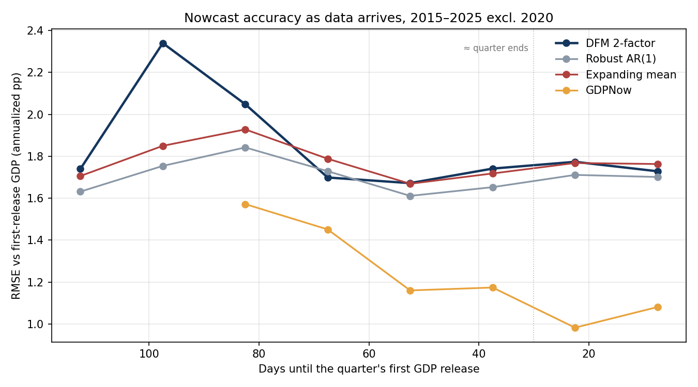
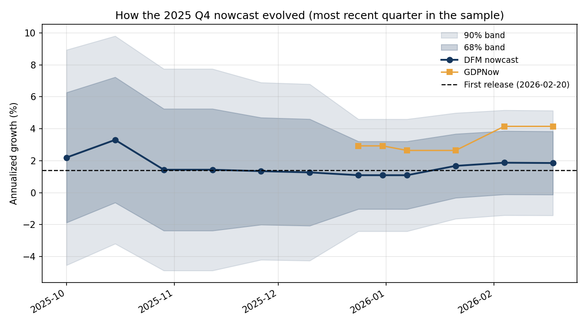
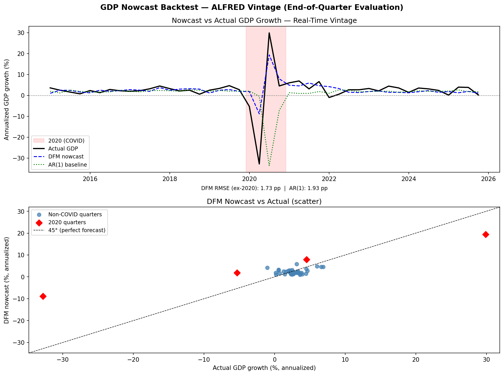
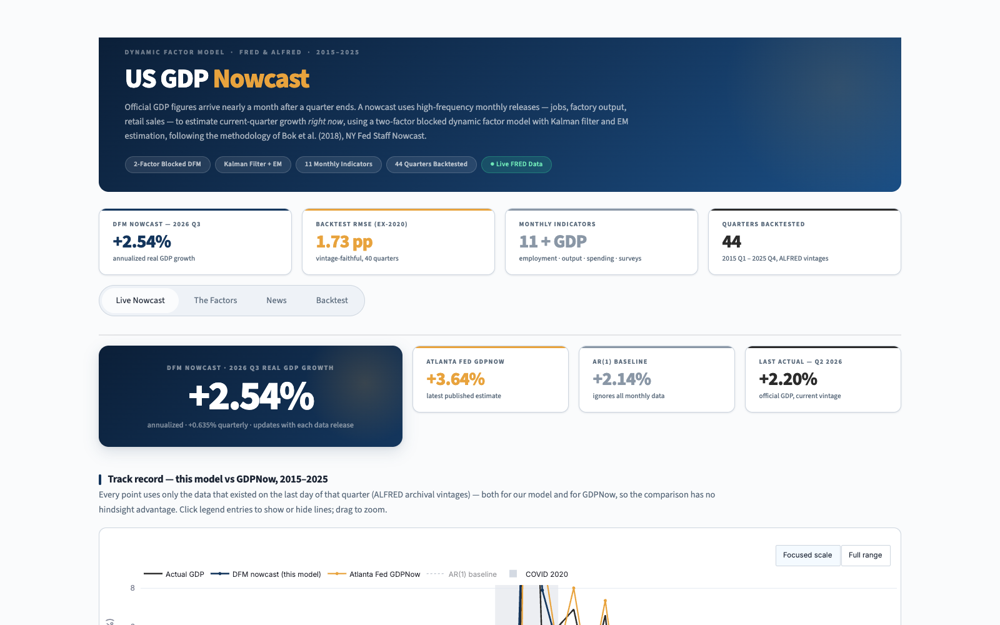
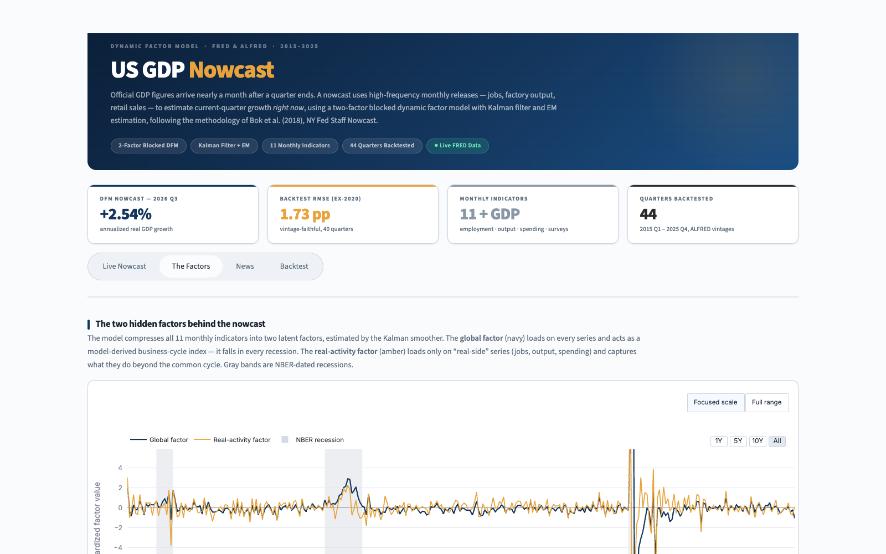
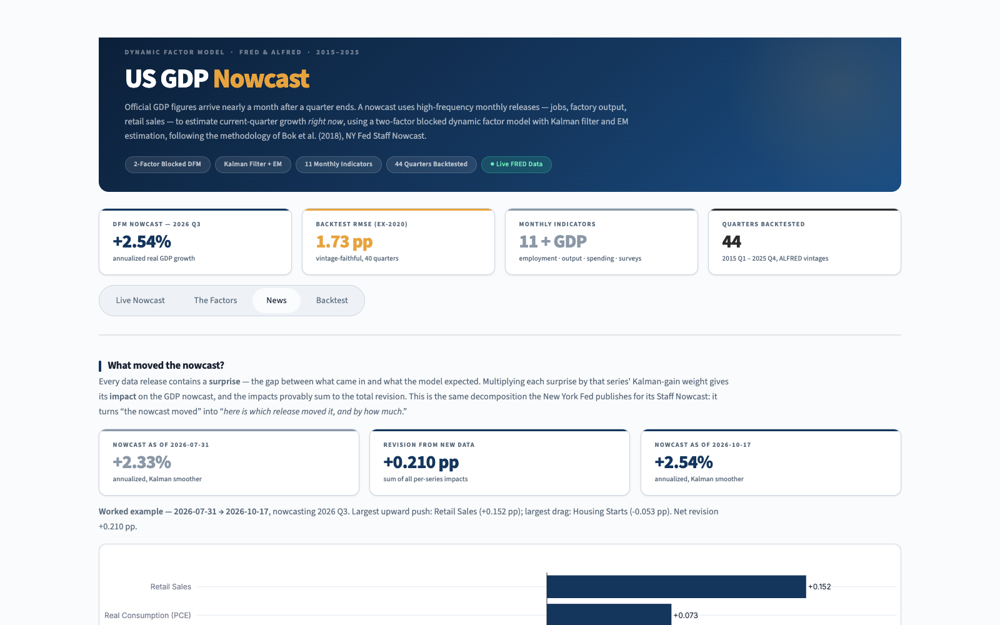
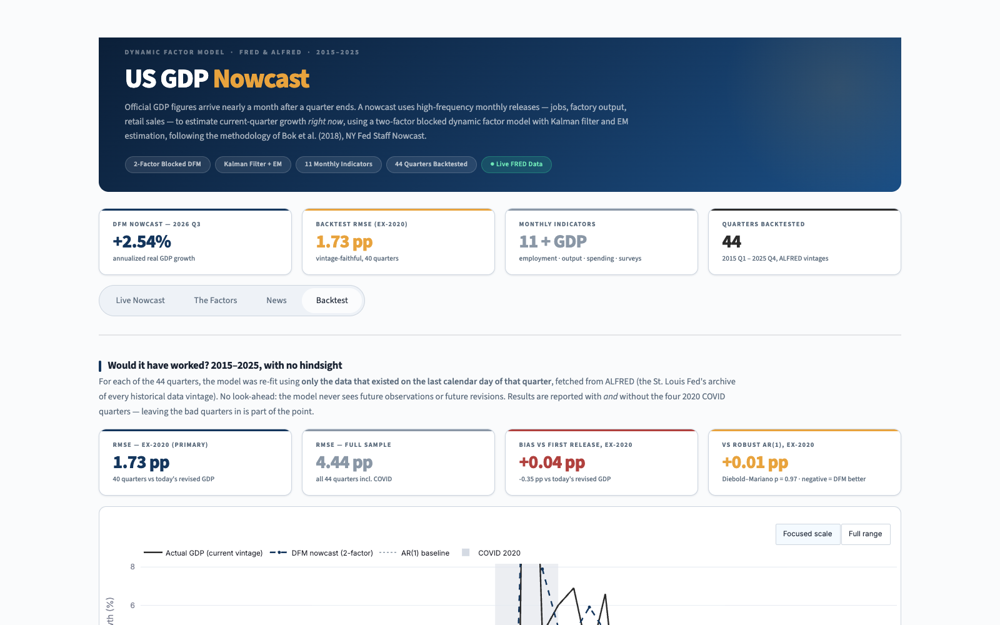

# Nowcasting US GDP with a Mixed-Frequency Dynamic Factor Model

**🔗 Live nowcast:** [https://jrussellgoodman.github.io/gdp_nowcaster/](https://jrussellgoodman.github.io/gdp_nowcaster/) — updated daily

A real-time estimate of current-quarter US real GDP growth, built with a
mixed-frequency dynamic factor model (DFM) estimated by Kalman filter and the
EM algorithm — the methodology behind the [New York Fed Staff Nowcast](https://www.newyorkfed.org/research/policy/nowcast).
The model is implemented with `statsmodels`' `DynamicFactorMQ`, backtested
against real-time data vintages from ALFRED, and benchmarked against the
Atlanta Fed's GDPNow and three simple real-time baselines.

> **Correction (October 2026).** Results published here before October 2026
> were produced by a nowcast-extraction bug: the code read the model's GDP
> estimate from the wrong month, in standardized (z-score) units, and from the
> one-step-ahead prediction rather than the smoother. The old headline
> (RMSE 2.87 pp ex-2020, a "−2 pp vintage bias", "AR(1) wins in calm times")
> is withdrawn. All numbers below come from the corrected code; the old and
> new figures are compared side by side in §3.5.

---

## Abstract

Official GDP is published with a lag of nearly a month after a quarter ends,
yet dozens of monthly indicators - payrolls, industrial production, retail
sales, regional Fed surveys - arrive continuously throughout the quarter. A
*nowcast* exploits these higher-frequency releases to estimate GDP growth for
the quarter currently in progress. This project implements a two-factor blocked
dynamic factor model on 11 monthly US indicators plus quarterly real GDP
(12 series in the model), following Bok, Caratelli, Giannone, Sbordone &
Tambalotti (2018). The model handles mixed sampling frequencies and ragged-edge
data within a state-space framework, estimates latent factors with the Kalman
filter and smoother, fits parameters by EM, and decomposes each nowcast
revision into the contribution of individual data releases ("the news").

Evaluated on 44 quarters (2015 Q1 – 2025 Q4), each nowcast made from the
ALFRED data vintage that existed on the last day of the quarter, the model's
real-time RMSE is **1.73 annualized percentage points excluding 2020** (4.44
including it) against today's GDP figures, and 1.77 against GDP as first
published, where it is essentially unbiased (+0.04 pp). **In normal quarters
that is statistically indistinguishable from simple baselines** — a robust
AR(1) scores 1.72 and the historical mean 1.84 (Diebold–Mariano p ≥ 0.7). The
DFM's advantage is concentrated in 2020, the only period in which it called the
direction of the collapse and rebound; with four such quarters that advantage
is large (13.7 vs 22.8–36.3 pp RMSE) but not statistically significant. The
Atlanta Fed's GDPNow, built on far more source data, is clearly more accurate
(0.98 vs 1.77 pp against first-release GDP, p = 0.01).

Re-running the evaluation **every two weeks through each quarter** (448
nowcasts, each from that day's archived data) shows where the gap comes from:
the DFM's error falls from 1.94 to 1.71 pp by mid-quarter and then plateaus,
while GDPNow keeps improving to 1.02 pp as hard data for the quarter's final
month arrives. The model's uncertainty bands turn out to be the most
informative result: its 68% bands contain the outcome 82% of the time overall,
but **91% in 2015–19, 73% in 2021–25 and 8% in 2020** — a constant-variance
model is too cautious in calm years and badly overconfident in a crisis.

---

## 1. Methodology

### 1.1 The dynamic factor model

The core idea is that a handful of unobserved (latent) factors drive the
co-movement of many observed economic series. Let $x_t$ be the $n \times 1$
vector of (stationary-transformed, standardized) indicators at month $t$. Each
series is modeled as a linear combination of $r$ common factors $f_t$ plus an
idiosyncratic component $e_{i,t}$:

$$
x_{i,t} = \lambda_i' f_t + e_{i,t}, \qquad i = 1, \dots, n
$$

where $\lambda_i$ is the $r \times 1$ vector of **factor loadings** for series
$i$. The factors follow a vector autoregression (the **transition equation**):

$$
f_t = A_1 f_{t-1} + \dots + A_p f_{t-p} + u_t, \qquad u_t \sim N(0, Q)
$$

and each idiosyncratic term follows its own AR(1), $e_{i,t} = \rho_i e_{i,t-1}
+ \varepsilon_{i,t}$, which absorbs series-specific dynamics so they don't
contaminate the common factors. Together the measurement and transition
equations form a linear Gaussian **state-space model**.

This project uses a **blocked** two-factor specification:

- a **global factor** that loads on all 12 series (the 11 indicators and GDP) and behaves as a
  model-derived business-cycle index (it falls in every NBER recession);
- a **real-activity factor** that loads only on the "real-side" series (jobs,
  output, consumption, orders, income), capturing what they share *beyond* the
  common cycle.

The blocked structure (LLF −3510) materially out-fits a single global factor
(LLF −3682) in-sample (June 2026 data). Out of sample it is no better: the two
specifications tie in normal quarters (1.73 vs 1.75 pp) and the one-factor
model is more accurate in 2020 (§3) — a reminder that in-sample fit is not
forecast accuracy.

### 1.2 Mixed frequency and the ragged edge

GDP is quarterly; the indicators are monthly; and at any given moment the most
recent month is available for some series but not others (the "ragged edge").
The state-space form handles all of this naturally. Following Mariano & Murasawa
(2003), a quarterly variable is treated as a monthly variable observed only
every third month, linked to its unobserved monthly counterpart by a fixed
aggregation rule. Missing observations — whether from frequency mismatch or the
ragged edge — are simply skipped in the Kalman recursions; the filter projects
through them using the model dynamics. This is exactly why a partially-observed
current quarter can still be nowcast: the missing GDP value is just another
state the filter infers from the monthly data that *has* arrived.

### 1.3 Estimation: Kalman filter, smoother, and EM

Given parameters $\theta = \{\Lambda, A, Q, \rho, \dots\}$, the **Kalman filter**
computes the optimal (minimum-MSE) estimate of the latent factors conditional
on data up to time $t$, $\mathbb{E}[f_t \mid x_{1:t}]$, by recursively
alternating a *prediction* step and an *update* step that corrects the
prediction by the forecast error (the "innovation") weighted by the Kalman
gain. The **Kalman smoother** then runs backward to condition on the *full*
sample, $\mathbb{E}[f_t \mid x_{1:T}]$ — this is what the dashboard plots as the
factors. The nowcast itself is the smoothed estimate of GDP growth at the
**last month of the target quarter**, where the model stores quarterly GDP,
converted back from the model's standardized units (`extract_nowcast` in
`src/model/dfm.py`).

The parameters themselves are unknown, so they are estimated by the
**Expectation–Maximization (EM)** algorithm, which is well suited to latent-
variable models with missing data:

- **E-step:** with $\theta$ fixed, run the Kalman smoother to compute the
  expected complete-data log-likelihood (i.e., infer the factors).
- **M-step:** with the inferred factors fixed, update $\theta$ by closed-form
  regressions that maximize that likelihood.

Iterating drives the log-likelihood monotonically upward to a (local) maximum.
We do **not** hand-roll any of this — both the Kalman recursions and the EM
loop are provided by `statsmodels.tsa.statespace.DynamicFactorMQ`, which
implements precisely the Bok et al. (2018) framework.

### 1.4 News decomposition

When new data is released, the nowcast changes. The **news decomposition**
attributes that change to individual releases. The revision in the nowcast of
target variable $y$ between an old and a new data vintage is

$$
\underbrace{\hat{y}_{\text{new}} - \hat{y}_{\text{old}}}_{\text{revision}}
= \sum_{j} \, w_j \underbrace{\left(x_j - \mathbb{E}[x_j \mid \text{old data}]\right)}_{\text{news (surprise)}}
$$

Each newly observed value $x_j$ contains a **surprise** — the gap between what
was released and what the model expected given the old information set. The
surprise is multiplied by a Kalman-gain-derived **weight** $w_j$ to give that
release's **impact** on the nowcast. The impacts provably sum to the part of
the revision due to new data (verified in `tests/test_news.py` to a tolerance
of $10^{-5}$); both nowcasts are smoothed estimates with parameters held fixed,
so the "after" nowcast equals the Live Nowcast. This is
the same decomposition the NY Fed publishes each week, turning "the nowcast
moved" into "*here is which release moved it, and by how much*."

> **Reference.** Bok, B., Caratelli, D., Giannone, D., Sbordone, A. M., &
> Tambalotti, A. (2018). *Macroeconomic Nowcasting and Forecasting with Big
> Data.* Federal Reserve Bank of New York Staff Report No. 830.
> [Link](https://www.newyorkfed.org/research/staff_reports/sr830). Mixed-
> frequency aggregation follows Mariano, R. S., & Murasawa, Y. (2003),
> *A New Coincident Index of Business Cycles Based on Monthly and Quarterly
> Series*, Journal of Applied Econometrics, 18(4).

---

## 2. Data

All data is pulled from [FRED](https://fred.stlouisfed.org) (current values) and
[ALFRED](https://alfred.stlouisfed.org) (historical vintages) via the
`fredapi` client. The panel is 11 monthly indicators spanning output, the labor
market, consumption, housing, orders, income, prices, and regional Fed surveys,
plus quarterly real GDP as the target — 12 series in the model.

| FRED ID | Series | Freq | Transform | Group |
|---|---|---|---|---|
| `GDPC1` | Real GDP (chained 2017 $) | Q | log-difference | **Target** |
| `INDPRO` | Industrial Production Index | M | log-difference | Output |
| `PAYEMS` | Nonfarm Payroll Employment | M | log-difference | Labor |
| `UNRATE` | Unemployment Rate | M | first difference | Labor |
| `PCEC96` | Real Personal Consumption Expenditures | M | log-difference | Consumption |
| `RSAFS` | Advance Retail & Food Services Sales | M | log-difference | Consumption |
| `HOUST` | Housing Starts | M | log-difference | Housing |
| `DGORDER` | Durable Goods New Orders | M | log-difference | Orders |
| `DSPIC96` | Real Disposable Personal Income | M | log-difference | Income |
| `CPIAUCSL` | CPI, All Urban Consumers | M | log-difference | Prices |
| `GACDISA066MSFRBNY` | NY Fed Empire State Survey (general conditions) | M | level | Survey |
| `GACDFSA066MSFRBPHI` | Philly Fed Business Outlook (general activity) | M | level | Survey |

Each series is transformed to stationarity before estimation (log-differences
for trending levels ≈ growth rates; first differences for the unemployment
rate, already in percent; survey diffusion indices used in levels) and then
standardized. Growth rates are reported annualized as **4 × the quarterly log
change**. BEA's headline rate compounds instead, $(Y_t/Y_{t-1})^4-1$; the two
differ by under 0.1 pp in normal quarters but by several points in 2020
(e.g., 2020 Q2 as first published: −39.9 here, −32.9 in BEA's convention).
GDPNow is converted to these units wherever it is compared.

> **A note on ISM/PMI.** The widely-used ISM Manufacturing PMI (FRED `NAPM*`)
> was **removed from FRED in 2014** for licensing reasons. The NY Fed (Empire
> State) and Philadelphia Fed (Business Outlook) regional survey diffusion
> indices are used as freely-available substitutes.

### 2.1 Avoiding look-ahead bias with ALFRED vintages

The central discipline of an honest nowcast backtest is that **the model must
never use a number that did not exist at the time**. Two distinct look-ahead
traps arise: (1) using monthly data that had not yet been *released*, and (2)
using the *revised* value of a number whose first estimate was different.

To avoid both, every historical nowcast is computed from the **ALFRED data
vintage** as it stood on the last calendar day of the target quarter. ALFRED
archives every revision of every series with its `realtime_start` /
`realtime_end` window, so we can reconstruct the dataset a forecaster would
have had on, say, 30 June 2018 — pre-revision values, ragged edge and all. The
model is re-fit from scratch on each quarter's vintage. `assert_no_lookahead`
(in `src/backtest/vintage.py`) is a hard check that every evaluation date falls
on or before the end of its target quarter, i.e. before that quarter's GDP is
published.

What the model can see on that date matters for interpreting the results: on
average about 11 of 11 monthly series are published for the quarter's first
month, 10.6 for the second, but **only 2 for the third** (the two regional Fed
surveys) — payrolls, industrial production and retail sales for the third month
come out the following month. A quarter-end nowcast is therefore built mostly
from two months of hard data.

**Rebuilding vintages efficiently.** The through-the-quarter evaluation needs
about 5,000 (series, date) vintages, and each direct ALFRED request takes ~2 s
under a rate limit. Instead, each series' complete revision history is fetched
once and the vintage on any date is rebuilt locally — the latest value
published on or before it, keeping values ALFRED records as explicitly missing
(e.g., data skipped during the 2025 shutdown). Checked against all 1,036
vintages previously fetched directly: identical. 13 requests instead of ~5,000.

**Two scoring targets.** Nowcasts are scored against both (a) today's revised
GDP ("current vintage") and (b) GDP growth as first published — usually the
advance estimate, ~30 days after the quarter; built from ALFRED using the
actual publication date, which handles the shutdown-delayed releases of 2018 Q4
and 2025 Q3/Q4. Between the two, GDP growth has been revised up by +0.38 pp on
average (ex-2020), which shifts every model's measured bias by the same amount.

---

## 3. Results

### 3.1 Accuracy as data arrives (through-the-quarter evaluation)

A nowcast is updated continuously, so the standard way to judge one is how its
accuracy improves as the quarter's data comes in. Each of the 44 quarters was
nowcast every 14 days from its first day — plus on its last day — up to the day
before its GDP was first published: **448 nowcasts**, each from the ALFRED
vintage of that day (no look-ahead: every date precedes the release, and the
quarter-end rows reproduce the §3.3 backtest exactly). The design was written
into `docs/progress.md` before any results were computed.



RMSE excluding 2020, scored against GDP as first published (annualized pp):

| Days before GDP release | > 60 | 31–60 | 1–30 |
|---|---:|---:|---:|
| **DFM 2-factor (this model)** | **1.94** | **1.71** | **1.76** |
| DFM 1-factor | 1.99 | 1.79 | 1.84 |
| Robust AR(1) | 1.71 | 1.63 | 1.71 |
| Expanding mean | 1.79 | 1.69 | 1.77 |
| AR(1) | 1.81 | 1.79 | 1.88 |
| GDPNow | 1.47 | 1.17 | 1.02 |
| *DM p, DFM vs robust AR(1)* | *0.24* | *0.82* | *0.83* |
| *DM p, DFM vs GDPNow* | *0.08* | *0.05* | *0.02* |

Diebold–Mariano tests average each quarter's losses first, because several
nowcasts of the same quarter fall in each window and are not independent.
Full grid (both targets, both samples): `data/horizon_accuracy.csv`,
`data/horizon_tests.csv`.

**What it shows.** The DFM gains most of its accuracy by mid-quarter (early in
the quarter it must forecast two quarters ahead, since the previous quarter's
GDP isn't out yet) and then stops improving — consistent with §3.4: the hard
data for the quarter's last month adds little to this model. GDPNow's error
keeps falling, to 1.02 pp, and its advantage is significant in the last two
windows. At no horizon does the DFM significantly beat the simple baselines.

### 3.2 Are the uncertainty bands honest?

Each nowcast comes with a standard error from the Kalman smoother, giving 68%
and 90% bands (these ignore uncertainty in the estimated parameters). A
calibrated 68% band contains the outcome about 68% of the time.

| Excluding 2020, first-release target | 68% band contained outcome | 90% band | Typical band (±pp) | CRPS |
|---|---:|---:|---:|---:|
| > 60 days before release | 85% | 98% | 2.56 | 1.04 |
| 31–60 days | 80% | 94% | 1.83 | 0.90 |
| 1–30 days | 79% | 93% | 1.72 | 0.92 |
| **All horizons** | **82%** | **96%** | 2.16 | 0.98 |

The pre-registered expectation was that the bands would be *too narrow*; they
are too *wide* overall. A follow-up split by period (post-hoc — chosen after
seeing the results, `data/calibration_by_period.csv`) explains why:

| Period | Typical band (±pp) | Actual RMSE | 68% band held | 90% band held |
|---|---:|---:|---:|---:|
| 2015–2019 | 1.52 | 0.95 | 91% | 100% |
| 2020 | 2.04 | 15.41 | 8% | 10% |
| 2021–2025 | 2.78 | 2.41 | 73% | 92% |

The model assumes one fixed level of noise, estimated from its whole sample.
Before 2020 that sample includes the 2008 recession, so calm-period bands are
too wide; in 2020 the bands could not widen for an unprecedented shock; after
2020, with COVID in the sample, they roughly double and become about right.
This is the standard argument for adding **stochastic volatility** to
nowcasting models — a natural next step for this project.



*Example: how the 2025 Q4 nowcast evolved (chosen by rule: the most recent
quarter, not the best-looking one). The flat stretch in October–November is the
2025 government shutdown, when no new monthly data was published.*

Out-of-sample evaluation covers **44 quarters, 2015 Q1 – 2025 Q4**, each nowcast
made from that quarter's end-of-quarter ALFRED vintage. Results are reported
both with and without the four 2020 COVID quarters — leaving the catastrophic
quarters in is part of the point, not something to cherry-pick around.

### 3.3 Quarter-end accuracy vs. benchmarks

All benchmarks use only the GDP data published by each evaluation date:
**AR(1)** (OLS, the original baseline), **Robust AR(1)** (Huber regression, so
one crash-and-rebound pair can't drag the slope to ≈ 1), and **Expanding mean**
(average growth since 2000 — "predict the average"). GDPNow is the Atlanta
Fed's own end-of-quarter nowcast, archived in ALFRED only from 2016 Q2.
Annualized percentage points; bias = nowcast − actual.

**Scored against today's revised GDP**

| Model | RMSE ex-2020 ★ | RMSE full | RMSE 2020 | Bias ex-2020 | Quarters |
|---|---:|---:|---:|---:|---:|
| **DFM 2-factor (this model)** | **1.73** | **4.44** | 13.67 | −0.35 | 44 |
| DFM 1-factor | 1.75 | 2.96 | 8.10 | −0.29 | 44 |
| Robust AR(1) | 1.72 | 8.12 | 26.37 | −0.50 | 44 |
| Expanding mean | 1.84 | 7.09 | 22.79 | −0.81 | 44 |
| AR(1) | 1.93 | 11.10 | 36.31 | −0.82 | 44 |
| GDPNow | 1.33 | 3.43 | 9.98 | −0.13 | 39 |

**Scored against GDP as first published**

| Model | RMSE ex-2020 | RMSE full | RMSE 2020 | Bias ex-2020 | Quarters |
|---|---:|---:|---:|---:|---:|
| **DFM 2-factor (this model)** | **1.77** | **5.30** | 16.66 | +0.04 | 44 |
| DFM 1-factor | 1.82 | 3.48 | 10.01 | +0.10 | 44 |
| Robust AR(1) | 1.70 | 8.67 | 28.23 | −0.12 | 44 |
| Expanding mean | 1.76 | 7.78 | 25.19 | −0.42 | 44 |
| AR(1) | 1.87 | 11.42 | 37.41 | −0.44 | 44 |
| GDPNow | 0.98 | 2.44 | 7.05 | +0.16 | 39 |

★ Headline metric (40 non-2020 quarters).

**Is any of this significant?** With 40 normal quarters, RMSE gaps of a few
tenths are easily noise. `scripts/evaluate_backtest.py` reports a
Diebold–Mariano test (Harvey–Leybourne–Newbold small-sample version) and a
95% block-bootstrap interval for each RMSE gap (negative = DFM better):

| DFM 2-factor vs. | Sample | Target | RMSE gap | 95% CI | DM p |
|---|---|---|---:|---|---:|
| Robust AR(1) | ex-2020 | current | +0.01 | −0.45 to +0.42 | 0.97 |
| Expanding mean | ex-2020 | current | −0.11 | −0.66 to +0.39 | 0.71 |
| AR(1) | ex-2020 | current | −0.20 | −0.90 to +0.39 | 0.55 |
| Robust AR(1) | full | current | −3.68 | −6.71 to +0.34 | 0.20 |
| AR(1) | full | current | −6.66 | −12.25 to +0.29 | 0.25 |
| GDPNow | ex-2020 | first release | +0.88 | +0.31 to +1.44 | 0.01 |

Full grid (both targets, both DFM specs): `data/evaluation_tests.csv`.

**Reading this honestly:**

1. **In normal quarters the DFM does not beat simple baselines.** Its RMSE is
   within noise of the robust AR(1) and the historical mean on either scoring
   target. Predicting "roughly average growth" is hard to beat with 11 monthly
   indicators, and the third month of each quarter is mostly unpublished when
   the nowcast is made.
2. **Its advantage is 2020.** It is the only model here that called the
   direction of the 2020 collapse and rebound in real time (Q2 nowcast −8.8%
   vs. −32.8% actual; Q3 +19.4% vs. +29.9%), which is why its full-sample RMSE
   is far lower. But that rests on four quarters, so the full-sample gaps are
   not statistically significant either (p = 0.16–0.25).
3. **The bias is small.** Against first-release GDP the DFM is essentially
   unbiased (+0.04 pp). Against today's GDP it is −0.35 pp, because GDP was
   revised up by +0.38 pp on average after first publication — a property of
   the target that shifts every model equally. (The "−2 pp vintage artifact"
   reported before October 2026 was the extraction bug, not data revisions.)
4. **GDPNow is better**, by 0.88 pp RMSE against first-release GDP (p = 0.01),
   unsurprisingly for a model built bottom-up from far more source data.
5. **The second factor doesn't pay off out of sample.** The one-factor model
   ties ex-2020 and is clearly better in 2020. The dashboard keeps the
   two-factor model because it was the design chosen before the backtest;
   switching on the basis of these results would be selecting on the test set.

### 3.4 Two diagnostics

**How much is just timing?** `scripts/diagnose_information_timing.py`
re-estimates each quarter from the *next* quarter-end vintage, when all three
months are published (target GDP hidden). This is not a real-time forecast,
only a measure of what month 3 is worth: ex-2020 RMSE improves from 1.75 to
1.57 pp and the correlation with the actual from 0.26 to 0.37 (39 quarters).

**Persistence.** Even then, the estimate correlates more with *last* quarter's
GDP (0.55) than with the current one, while actual GDP growth has little
persistence (autocorrelation 0.21 ex-2020). The fitted model gives GDP small
factor loadings and a strongly negative monthly idiosyncratic AR(1) (≈ −0.8),
aggregated over the same five-month window that overlaps the previous quarter,
so part of each nowcast is carried-over GDP dynamics rather than new monthly
information. This is a specification question, left for future work rather
than tuned against the backtest.

### 3.5 Before and after the October 2026 fix

2-factor model, current-vintage target. The middle column scores the old
nowcasts against today's GDP to separate the fix from GDP revisions since June.

| | Old (as published) | Old nowcasts, today's GDP | **Corrected** |
|---|---:|---:|---:|
| RMSE ex-2020 | 2.87 | 2.87 | **1.73** |
| RMSE full sample | 7.71 | 7.71 | **4.44** |
| RMSE 2020 only | 23.89 | 23.89 | **13.67** |
| Bias, full / ex-2020 | −2.09 / −2.06 | −2.12 / −2.09 | **+0.23 / −0.35** |
| corr(nowcast, actual), full / ex-2020 | 0.15 / 0.07 | 0.15 / 0.08 | **0.87 / 0.29** |
| corr(nowcast, previous quarter's actual), full / ex-2020 | 0.85 / 0.54 | 0.85 / 0.54 | **−0.31 / 0.53** |

1-factor: RMSE ex-2020 2.92 → 1.75, full 8.18 → 2.96, 2020 25.49 → 8.10.

What was wrong: `extract_nowcast` read `results.fittedvalues` at the
quarter's *first* month. In `DynamicFactorMQ` the quarterly GDP observation sits
at the quarter's *last* month; the first month holds a Mariano–Murasawa window
centred on the previous quarter (hence the 0.85 correlation with last quarter's
GDP). `fittedvalues` is also in the model's standardized units and is a
one-step-ahead prediction. The news decomposition had three further problems —
it ran backwards (before ↔ after), passed the impact date under a misspelled
keyword that statsmodels silently ignored, and standardized the "before" data
differently. All are fixed and covered by regression tests that fail on the old
code (`tests/test_dfm.py::TestExtractNowcastRealFit`,
`tests/test_news.py::TestNewsIntegration`).

### 3.6 Charts

The Streamlit dashboard renders these interactively; static versions live in
[`docs/figures/`](docs/figures/).

**Real-time track record — DFM vs. AR(1) vs. actual, 2015–2025** (the dashboard adds GDPNow)


**Live dashboard — nowcast, factors, news, and backtest tabs**
| Live Nowcast | The Factors |
|---|---|
|  |  |
| **News Decomposition** | **Backtest** |
|  |  |

---

## 4. Running it locally

**Requirements:** Python 3.11+ and a free [FRED API key](https://fred.stlouisfed.org/docs/api/api_key.html).

```bash
# 1. Clone and enter the project
git clone https://github.com/jrussellgoodman/gdp_nowcaster.git gdp-nowcast && cd gdp-nowcast

# 2. Create and activate a virtual environment
python3 -m venv .venv
source .venv/bin/activate          # Windows: .venv\Scripts\activate

# 3. Install dependencies
pip install -r requirements.txt

# 4. Add your FRED API key
cp .env.example .env               # then edit .env and set FRED_API_KEY=...

# 5. Launch the dashboard
streamlit run app/streamlit_app.py
```

On first load the app downloads the FRED series (cached to `data/` afterward)
and fits the DFM by EM, which takes ~30 seconds; subsequent interactions are
near-instant thanks to in-memory caching.

```bash
# Unit tests only (94 tests, no API key needed — what CI runs)
pytest -q -m "not integration"

# Everything, incl. 16 integration tests that fit real models on FRED/ALFRED data
pytest -q
```

### Reproducing the backtest

```bash
python scripts/run_phase4_backtest.py           # 1-factor → data/backtest_results.csv
python scripts/run_phase4_backtest_2factor.py   # 2-factor → data/backtest_results_2factor.csv
python scripts/evaluate_backtest.py             # scorecard → data/evaluation_*.csv
python scripts/precompute_news_example.py       # dashboard's worked news example
python scripts/run_horizon_backtest.py          # 448 through-the-quarter nowcasts (~15 min)
python scripts/evaluate_horizon.py              # horizon accuracy, calibration, figures
```

The first run downloads ~530 ALFRED vintage files (rate-limited, with
automatic back-off; a few minutes). After that everything is cached in
`data/alfred/` and both backtests run in about a minute.
`scripts/rerun_failed_quarters.py` re-runs any quarter that failed. See
[CONTRIBUTING.md](CONTRIBUTING.md) for details.

### Project structure

```
src/
  data/      FRED/ALFRED fetching, transforms, mixed-frequency panel
  model/     DynamicFactorMQ wrapper, AR(1) baseline, news decomposition
  backtest/  real-time vintage backtest, look-ahead checks, evaluation statistics
app/         Streamlit dashboard (streamlit_app.py, theme.py, styles.css)
tests/       pytest suite + published-value sanity checks
docs/        progress log, design system, figures
scripts/     backtests, evaluation, diagnostics, data prep, screenshots
```

---

## 5. Limitations

- **Uncertainty bands don't adapt.** They are too wide in calm periods and far
  too narrow in 2020 (§3.2); the model has a single, constant noise level.
- **Accuracy plateaus by mid-quarter**, while GDPNow keeps improving (§3.1).
- **No demonstrated edge in normal times.** Ex-2020 the DFM is statistically
  indistinguishable from a robust AR(1) or the historical mean (§3.3), and
  GDPNow is significantly better.
- **2020 is both its best and worst period.** The worst miss is 2020 Q2 (nowcast
  −8.8% vs. actual −32.8%, a 24 pp error), yet it was the only model here to get
  the direction of 2020 right. Four quarters cannot establish a reliable edge.
- **The third month adds little.** At quarter-end only 2 of 11 series have
  third-month data, and the nowcast leans on the previous quarter's data
  (§3.4). Nowcasts made after the quarter ends, once that data is published,
  are no more accurate for this model (§3.1) — unlike GDPNow, which builds GDP
  up from its components and keeps improving.
- **FRED-only data excludes licensed series.** The ISM/PMI surveys, among the
  most informative monthly indicators, are not on FRED (removed 2014). Regional
  Fed surveys substitute but are noisier. The panel is 11 monthly series;
  the NY Fed Staff Nowcast and GDPNow draw on much larger sets of source data.
- **Units.** Growth is 4 × log change, not BEA's compounded rate (§2); the two
  differ materially only in 2020.
- **News decomposition timing.** The "before" dataset is clipped by observation
  date; GDP quarters are masked until their advance release, but a monthly
  value for the month containing the cutoff may have been published shortly
  after it.
- **Local maxima / convergence.** EM is run to a fixed tolerance and can stop at
  a local optimum; in a few quarters the maximum-iteration cap is reached. The
  factors are identified only up to a sign reversal, so loading *signs* across
  the two factors follow opposite conventions (documented in the dashboard).
- **Not an official forecast.** This is a student research project built as a
  learning tool, not investment or policy advice.

---

## License & attribution

Code: MIT License (see [LICENSE](LICENSE)).
Data © Federal Reserve Bank of St. Louis (FRED/ALFRED) and the Atlanta Fed
(GDPNow), used under their terms. Methodology after Bok et al. (2018), FRBNY
Staff Report 830. Built with [`statsmodels`](https://www.statsmodels.org/)
`DynamicFactorMQ`.
